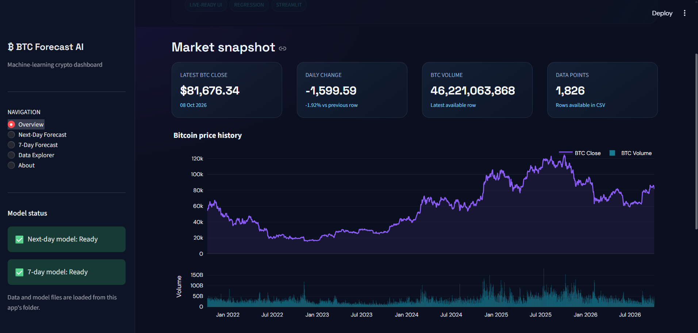
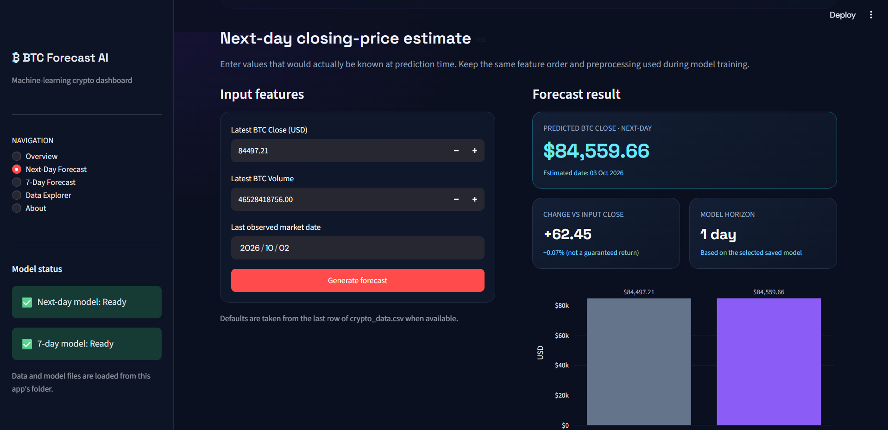
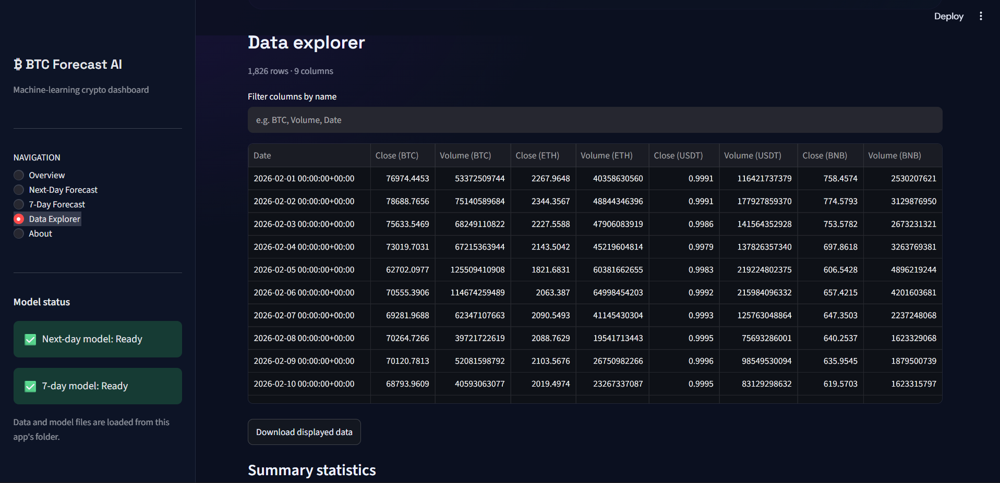

# Bitcoin Price Prediction using Machine Learning

## About the Project
This project uses Machine Learning to predict Bitcoin (BTC) closing prices for the next day and the next 7 days using historical cryptocurrency data.

## Technologies Used
- Python
- Pandas and NumPy
- Scikit-learn
- yfinance
- Matplotlib and Seaborn
- Streamlit / Gradio

## Models Used
- Linear Regression
- MLPRegressor (Multi-Layer Perceptron)

## Features
- Historical Bitcoin price analysis
- Exploratory Data Analysis (EDA)
- Next-day BTC closing price prediction
- Next-7-day BTC closing price prediction
- Saved models using Pickle
- Interactive local web application

## Project Files
- `Bitcoinpriceprediction.ipynb` — Model training and analysis
- `app.py` — Web application
- `btc_next_day_lr.pkl` — Next-day prediction model
- `btc_next_7day_mlp.pkl` — Next-7-day prediction model
- `crypto_08_OCT_2026.csv` — Cryptocurrency dataset

## How to Run

Install the required libraries:

```bash
pip install pandas numpy scikit-learn yfinance streamlit gradio
```

Run the application:

```bash
streamlit run app.py
```

## Application Screenshots

### 1. Dashboard Overview


### 2. Next-Day Forecast


### 3. Data Explorer


### 4. About the Project


## Disclaimer
This project is for educational purposes only. Cryptocurrency price predictions are not guaranteed to be accurate and should not be considered financial advice.
